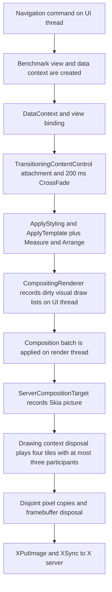

# First-opening investigation on Avalonia 12.1.4.4

Investigation date: 2026-10-16. The remaining cost in Controls and Icons is
substantially in the UI measure phase, which also realizes templates, applies
styles and formats text. These phase times are elapsed wall time, including JIT,
pauses and waits, rather than exclusive CPU. They are not evidence of an inefficient geometric panel
algorithm alone. No small shared performance patch is qualified for release by
this investigation. A prototype removes a real allocation, but its timing benefit
is inconsistent and TextBlock has no allocation saving. Keep the existing three-worker
raster profile; adding general UI or text parallelism is not justified.

## Sources and baseline

The required immutable tag `bilanciai/12.1.4.4` resolves to
`654488b60eb8485aef6d47ed2bc49954a96bcc9a`. The original fork checkout was clean at
`0b6c5160e2bc63c508a2a4b51fb927c2cb54adde`; only three documentation/manifest files
differed from the release. Framework source therefore matched the required
baseline. The prototype worktree starts at the exact release commit.

Read together, without pooling their populations:

- [Patch register](BILANCIAI_PATCHES.md) and [distribution](BILANCIAI_DISTRIBUTION.md).
- Historical navigation benchmark, 2026-10-16, revision 4, self-contained
  .NET 10.0.13. Its three
  Release/fade medians were 1056.1/1023.1/537.2 ms for Controls/Icons/Dialogs;
  UI measure was 535.8/586.0/104.8 ms. These are historical observations, not a
  paired control for the new measurements below.
- Historical first-view benchmarks: mostly isolated-host investigations on 2026-10-15,
  including .NET 10.0.12 and revision-3 populations, and the later revision-4 text
  microbenchmark. The nested sampled stack times include waits/suspension.
- Historical renderer benchmarks use separate dependency generations.
  Animation FPS is not page latency.

BIL-AVA-009 is already in this baseline. Its 229.2 to 202.3 ms ARM64 result for
1,000 TextBlocks is an earlier microbenchmark, not a newly measured page gain.
The earlier revision-3 Debug/.NET 10.0.12 workload was not the experimental baseline.

## From navigation to framebuffer delivery

The benchmark uses application navigation and its normal transition, including
one return. View construction, binding and lifecycle callbacks occur before any
assurance of a drawn frame.

In the fork, [Layoutable.MeasureCore](../src/Avalonia.Base/Layout/Layoutable.cs)
calls `ApplyStyling` and `ApplyTemplate` before `MeasureOverride`. Child
DesiredSize, available constraints and parent layout therefore depend on earlier
work. [LayoutManager](../src/Avalonia.Base/Layout/LayoutManager.cs) processes
invalidations in ancestry order and can run additional measure/arrange passes for
viewport changes. Those passes cannot simply be parallelized or suppressed.

[CompositingRenderer.UpdateCore](../src/Avalonia.Base/Rendering/Composition/CompositingRenderer.cs)
calls `visual.Render` into the draw-list recorder and serializes changes.
[ServerCompositor.RenderCore](../src/Avalonia.Base/Rendering/Composition/Server/ServerCompositor.cs)
applies batches, updates targets, renders them, then executes post-target jobs.
`RequestCommitAsync` observes the earlier Processed endpoint.

The ARM64 application selects X11 software rendering with a retained framebuffer
and a separate render thread. This is the X11 framebuffer path, rather than a
direct Linux fbdev/DRM presentation experiment.
[FramebufferRenderTarget.CreateDrawingContext](../src/Skia/Avalonia.Skia/FramebufferRenderTarget.cs)
records a picture; its disposal calls `ParallelRaster.Render` and then disposes
the framebuffer in a `finally` block. The compositor render histogram stops
before that disposal. Each tile owns its surface/canvas/pixels, replays the
picture and copies a disjoint destination rectangle. `Parallel.For` joins before
picture disposal/framebuffer unlock. Its degree includes a possible calling
render-thread participant; three does not mean three dedicated extra threads.

[RetainedFramebuffer.Lock](../src/Avalonia.Base/Platform/RetainedFramebuffer.cs)
invokes the platform blit when released. Here
[X11FramebufferSurface.Blit](../src/Avalonia.X11/X11FramebufferSurface.cs) performs
`XPutImage` and `XSync`. The correlated drawing marker followed by a post-target
job includes this delivery path. It does not establish compositor presentation,
panel scanout, physical touch latency or the earliest possible visible pixel.

## New navigation workload comparison

Thirty retained fresh processes: five per page and worker setting. Each process
enters the benchmark application, executes the target navigation command,
records first opening, and returns once. Only `page-1` is compared. Worker order
alternates between repetitions; page order is reversed on even repetitions.

Both variants use the complete, unchanged `published-r4.tar.gz` bundle retained
by the previous navigation investigation, including `PageOpening.r2r.dll`.
No DLL was inserted into an existing composite image. The archive SHA256 is
`BF71D2D6D4D0326E3F80F9E0BCE3D43B656936C7BB872E6262C929059995C8C5`;
the composite SHA256 is
`FB7FC249055C1919E07582D8C1C0BE1DFA1AD1CA170AD964FB39069F10BC1E49`.
The compared first target opening precedes the return navigation. These runs do
not qualify subsequent openings or application lifecycle changes.

Benchmark platform: four Cortex-A53 cores, Linux ARM64, 1024 × 600, scale 1.
Every launch checks all four governors are `performance` and records their
1,600,000 kHz readings and temperature. Startup temperatures ranged 55–60 °C.
The application uses Release/self-contained .NET 10.0.13/composite R2R, tiering,
ThreadPool spin limit zero, four horizontal partitions, 24 Hz, mask shadows and
stroke cache. Content prefetch remains disabled. The only rendering setting
varied is worker degree 1 versus 3: degree 1 retains the same picture, four tiles
and full-frame copies as the serial control.

Every process binds fresh copies of the same configuration and data snapshot
and its own log folder inside a private mount namespace. No other benchmark
application instance was active. Four tail runs potentially overlapping a
diagnostic-file transfer were preserved in
`excluded-transfer-overlap`, excluded, and repeated in the same variant order.
The valid latency population has no EventPipe tracing.

Milliseconds, median [minimum–maximum]; no p95 estimate is made from five samples.

| Page | Workers | First batch | Settled batch | Settled MAD | UI measure | UI arrange |
| --- | ---: | ---: | ---: | ---: | ---: | ---: |
| Controls | 1 | 784.9 [768.4–873.4] | 948.5 [920.2–1025.6] | 25.3 | 449.7 | 12.9 |
| Controls | 3 | 769.4 [711.0–823.7] | 923.7 [862.6–973.9] | 9.5 | 451.7 | 12.4 |
| Icons | 1 | 759.9 [713.6–901.5] | 920.6 [859.8–1122.8] | 60.8 | 460.5 | 45.8 |
| Icons | 3 | 731.7 [695.7–754.2] | 887.3 [847.5–910.5] | 23.2 | 454.0 | 43.6 |
| Dialogs | 1 | 226.2 [196.2–260.3] | 503.9 [492.3–527.6] | 11.6 | 63.7 | 3.2 |
| Dialogs | 3 | 202.1 [195.6–228.0] | 513.2 [471.8–537.4] | 24.2 | 60.1 | 3.2 |

Raw settled samples in repetition order, milliseconds (full-precision endpoints
and all other metrics remain in `navigation-records.json`):

| Page | Workers | Repetitions 1 through 5 |
| --- | ---: | --- |
| Controls | 1 | 973.9, 920.2, 1025.6, 948.5, 939.2 |
| Controls | 3 | 973.9, 923.7, 920.6, 862.6, 933.2 |
| Icons | 1 | 1020.4, 1122.8, 891.4, 920.6, 859.8 |
| Icons | 3 | 887.3, 847.5, 910.5, 858.8, 892.4 |
| Dialogs | 1 | 524.6, 527.6, 503.9, 492.3, 502.2 |
| Dialogs | 3 | 478.1, 513.2, 520.2, 537.4, 471.8 |

The range overlap and mixed per-repetition differences do not establish a small
uniform latency advantage for either setting. They do establish that changing
raster degree does not remove the roughly 450 ms UI-measure cost in Controls and
Icons. Keep the already qualified three-worker default. This screening is not a
precise estimate of a two-percent effect; it supplies no basis for changing the
default or claiming zero possible effect. Additional samples would be needed
to attribute such a small change.

At three workers, median UI recording/render time is 42.8/16.1/4.0 ms for
Controls/Icons/Dialogs. UI JIT is 30.1/20.2/8.3 ms and overlaps measured phases.
Measure/arrange pass counts are consistently 3/3, 5/5 and 3/3 respectively;
these are global pass counts, not per-control invocation counts. Target visual
descendants are 151/173/29, including 51/39/9 TextBlocks (AccessText included).

| Page | Workers | Process CPU ms | Managed UI bytes | Managed process bytes |
| --- | ---: | ---: | ---: | ---: |
| Controls | 1 | 992.3 | 7,756,992 | 7,939,576 |
| Controls | 3 | 997.6 | 7,759,704 | 7,936,208 |
| Icons | 1 | 1078.2 | 7,872,184 | 8,039,384 |
| Icons | 3 | 1051.1 | 7,794,200 | 7,979,248 |
| Dialogs | 1 | 550.3 | 2,918,760 | 3,027,040 |
| Dialogs | 3 | 608.4 | 2,935,392 | 3,647,304 |

These are medians over the whole navigation interval, including shell, outgoing
page and application background work. CPU uses process processor time, rather
than time on the UI thread alone; X server CPU is outside it. UI allocation is a
thread counter, not allocation exclusively owned by the target view. Native Skia
allocations are excluded. All samples have zero Gen1/Gen2 collections. Gen0 is
normally two for Controls/Icons (one three-worker sample of each has one) and one
for Dialogs. The raw files retain all phase values, heap estimates and dispersion.

The Icons workload uses synchronous conversion and immediate vector fallback;
the provided content is drawable without waiting for a later raster cache.
Separate diagnostics distinguish absent content from pending asynchronous work.

## Repeated work and existing reuse

| Work category | Verified behavior and implication |
| --- | --- |
| Required once per instance | View, binding targets, namescope, template parts, logical parents, automation peers and event lifetimes cannot be shared as one live control tree. |
| Potential duplicate within opening | Changed text constraints reformat lines in Measure/Arrange. BIL-AVA-009 already avoids compatible layout replacement; the shaping cache often avoids reshaping even when formatting repeats. Empty logical-list creation and duplicate InlineCollection ownership assignments are smaller concrete cases below. |
| Already shared or cached | Template identity guard, styling flags, shareable StyleInstance per FrameType, font resolution and per-TextBlock shaping cache already exist. Adding another generic cache is not a finding. |
| Safely deferred in the tested workloads | Controls already retains a lazily created second tab. Icons already uses VirtualizingStackPanel. Neither improvement is new here; off-screen content cannot generally be skipped without preserving measure, focus, named parts, resources and accessibility. |

[Layoutable.Measure/Arrange](../src/Avalonia.Base/Layout/Layoutable.cs) already
skip valid identical constraints. `StyledElement.ApplyStyling` has separate style,
theme and templated-parent-theme flags. `TemplatedControl.ApplyTemplate` compares
template identity. `StyleBase.Attach` shares compatible style instances. An
ancestor traversal cannot stop merely because the nearest parent is valid:
higher invalid ancestors may change constraints. Layout queues already coalesce
active duplicates and guard invalidation loops.

## Ranked small shared candidates

The ranking concerns first-opening usefulness, rather than a commitment to merge.
None has a demonstrated whole-page latency gain against revision 4.

### 1 Avoid empty logical collections during internal traversal

Files: [StyledElement](../src/Avalonia.Base/StyledElement.cs), methods
`DataContextNotifying`, `OnAttachedToLogicalTreeCore`, `OnDetachedFromLogicalTreeCore`;
[TemplatedControl.ApplyTemplatedParent](../src/Avalonia.Controls/Primitives/TemplatedControl.cs).
Those paths ask the lazy getter for children only to enumerate an empty list.

The isolated prototype reads the nullable backing collection after lifecycle
callbacks and adds an internal `HasLogicalChildren` guard after assigning
TemplatedParent. It changes two framework files (+14/−9 lines). It preserves the
public/explicit getter's observable collection identity and subscription behavior;
returning a shared empty list there would break later CollectionChanged delivery.
Children added by callbacks must still participate in attachment, inheritance,
resources, styles and template-parent propagation.

Demonstrated saving: **22,952 bytes per 151 new Control/Image/Path leaves**, or
152 bytes per qualifying leaf. **TextBlock saves zero**: its constructor already
creates LogicalChildren for InlineCollection. Controls with real logical content
normally have a collection as well. Expected application impact is therefore
small, with low implementation cost but a lifecycle-sensitive boundary.

The Windows x64/.NET 10.0.13 Release microprobe uses five alternating fresh
processes per variant, disabled tiering, warmup and 15 repeated batches per
process. It measures construction plus logical attachment or template traversal;
it excludes Measure/Arrange, renderer and framebuffer. Representative process
median ranges overlap:

| 151 leaves | Baseline ms [process-median range] | Prototype ms [range] |
| --- | ---: | ---: |
| Control attachment | 0.45664 [0.43502–0.49304] | 0.45082 [0.42755–0.49795] |
| Control template | 0.36160 [0.33751–0.40159] | 0.37029 [0.35128–0.39634] |
| Image attachment | 0.46845 [0.45395–0.49947] | 0.43164 [0.42182–0.47525] |
| Path template | 0.42600 [0.35860–0.44035] | 0.42737 [0.40350–0.43939] |

All 114 targeted tests pass: 64 StyledElement/resource/theme tests including four
new callback/subscription regressions, plus 50 TemplatedControl/Decorator/
ContentControl tests. Builds have zero warnings/errors. The prototype remains
isolated; it was not promoted to an ARM64/composite navigation candidate because
this screen did not establish a useful general timing gain. These tests do not
constitute pixel, DPI or hardware qualification of a release.

### 2 Initialize TextBlock inline ownership once

[TextBlock constructor and OnInlinesChanged](../src/Avalonia.Controls/TextBlock.cs)
assign `InlineCollection.LogicalChildren` and `InlineHost` twice. The setters in
`InlineCollection` invalidate without an identity guard. The minimal hypothesis
is `Inlines = new InlineCollection();`, letting the existing change handler set
ownership. It avoids two redundant owner invalidations, with essentially unchanged
allocations, and can affect template-created labels in all three pages.

Benefit is unmeasured and expected to be tiny. Cost/risk are low relative to lazy
Inlines, but verification must include existing TextBlock tests, explicit null,
inline adoption, embedded controls, SelectableTextBlock subscriptions, subsequent
changes, wrapping/alignment/RTL, resize/DPI and geometry/pixel equivalence. This
is a source-backed hypothesis, not a new fix or an attributed bottleneck.

### 3 Specialize bidi reordering for one run

[BidiReorderer.BidiReorder](../src/Avalonia.Base/Media/TextFormatting/BidiReorderer.cs)
sets up scratch runs/ranges, reorders and clears them even for one run. A
one-element path could return the same TextRun with its original source index,
RunIndex 0 and NextRunIndex −1. Glyphs are already in visual order, including RTL.
It retains the output array allocation. Scope is simple one-run lines, not every
TextBlock or every multilingual paragraph; short labels may also contain an
additional terminator run. Benefit is unmeasured and likely small; cost is low,
but bidi/hit-test correctness makes risk higher than the constructor simplification.

Before prototyping, count actual one-run calls in Controls/Icons. Required tests:
LTR and RTL, nonzero source index, non-shaped runs, link terminator and existing
multi-run/bidi/formatter/pixel tests. No scratch-cache mutation may survive the
fast path. No implementation or timing result is claimed for this candidate.

## Multicore assessment

[BilanciaiSoftwareProfile](../src/Skia/Avalonia.Skia/BilanciaiSoftwareProfile.cs)
still selects three participants, four horizontal partitions and 24 Hz on Linux
ARM64, preserving explicit overrides. The framebuffer code retains serial drawing
fallback for unsupported retention/pixel conversion. The measured one-participant
control uses the identical tiled optimization serially, rather than disabling
visual effects or comparing unrelated renderers.

| Possible boundary | Ownership, dependencies and decision |
| --- | --- |
| Existing picture playback | Share the completed picture; each tile owns mutable native canvas/surface/pixels. Copies write disjoint destinations; join precedes framebuffer/picture disposal. Resize recreates tiles; allocation is not repeated for each new view. Keep maximum three on this device. Existing eight-pixel effect halo and custom/mutable native-resource limits still apply. |
| Measure/Arrange, styles, attachment and binding | Live control/property stores, resource inheritance, lifecycle and named template parts belong to the UI thread. Parent measure consumes child DesiredSize and actual constraints; callbacks can mutate the tree. No small independent immutable job boundary exists. Reject Task.Run/Parallel.ForEach over these objects. |
| Text shaping groups | Copied strings and value options could be independent, but the present full pipeline is not a proven thread-safe job. HarfBuzz buffers/bidi/pools are thread-local; GlyphTypeface's lazy TextShaperTypeface assignment, shared native HBFont/HBFace and Skia font callbacks, TextRunCache, ShapedBuffer caches and lazy GlyphRun remain mutable. Recommend zero added text workers for these pages. |
| Workload content preparation | The tested workload converts synchronously and already reuses content data. Off-thread preparation would need an explicit immutable-data boundary and safe ownership of mutable streams and provider scopes. It is not a small fork-wide fix for these pages; no content-prefetch change was evaluated. |

A technically valid future shaping experiment would capture the complete text
context, culture, resolved fallback fonts, features, size/spacing, bidi inputs and
resource/DPI generation on the owner thread. Each worker must own or safely retain
native font/shaper lifetime, use its own buffers and return detached glyph data.
The owner applies results only if content, resources and constraints still match;
obsolete results must be disposed. Inline controls and arbitrary callbacks stay
serial. Wrapping, line metrics and parent DesiredSize still need the actual
constraint and ordered child results.

Scheduling during Measure otherwise adds a synchronous wait or another layout
pass. Copies, font-resource setup, pooling retention, synchronization and stale
results can cost more than short-label shaping. UI plus three raster participants
already spans four cores when concurrent; there is no guaranteed spare core.
At most one bounded experimental worker during non-raster preparation would be a
reasonable first screen for sufficiently large independent groups. Compare the
same grouping serially, with identical fallback behavior and explicit disposal,
resource invalidation, cancellation and stale-result tests. No such parallel text
implementation has been justified or timed here.

## Rejected leads and next fork intervention

Do not extend BIL-AVA-009 by ignoring changed NoWrap constraints: public
TextLayout.MaxWidth/MaxHeight and existing changed-arrange tests require updated
semantics, even when glyph shaping is reused. Do not implement lazy Inlines as a
getter-only patch: explicit null, XAML collection content, direct-property reads
and SelectableTextBlock notifications must retain their observable behavior.

The previous selector-type prefilter lacked repeatable themed-page benefit, and
a broad TargetType cache broke mutable OR selectors. Font caching and the
deferred Controls tab are already implemented. Removing the transition is not a
general solution; the earlier no-fade result is a separate
population and no transition was removed in these tests.

The VirtualizingCarouselPanel own-container retention defect is confirmed by the
existing workload evidence, but is separate from first opening. Any eventual fork
fix belongs in removed/reset own-container handling, including re-add and
transition tests; it must not be credited as a first-opening optimization.

**Recommendation:** do not create a performance release from these small
candidates. The next shared fork intervention should be opt-in diagnostic scopes
at the existing Diagnostic boundary for actual template builds and TextLayout
creation/reformat reasons, paired with existing style/layout scopes. Aggregate
per type and per navigation, not per-view product instrumentation. This can
separate first-time realization from avoidable repeats before changing lifecycle
or text contracts. Promote a functional patch only when a substantial repeated
path is demonstrated and a rebuilt complete composite cohort improves the real
navigation workload at unchanged geometry, resources and behavior. Keep the
allocation prototype as evidence rather than attributing a page-speed improvement
to it.

## Evidence and verification scope

Local evidence is under ignored
`artifacts/local-checks/first-opening-20261016-v2` in this fork. It is not included
in a fresh clone and is not a build dependency. `Run-Comparison.ps1` and
`Summarize.ps1` preserve the benchmark navigation sequence, validate
binary/configuration identity and retain raw values, min/max and median absolute deviation. The
original navigation harness and startup hook were inspected and preserved.

The latency hook SHA256 is
`560C70E1CED98B61C3BD6A340AB8C0306ECDFE13B4C1BE040F7267523023CF81`.
`navigation-records.json` and `summary.json` identify the 30 retained processes
and 90 navigation operations; smoke, four excluded runs, microbenchmarks and
diagnostic traces are separate populations. The prototype has ten raw process
files, DLL hashes, source/patches, test logs and its own manifest. Package/source
provenance starts from the [revision-4 release manifest](bilanciai-releases/12.1.4.4.json);
executed R2R component bytes are identified separately from packaged IL.

The benchmark application bundle reports `1.0.0+local`; its exact complete binary
image is retained and hashed. A fresh source build is not claimed to reproduce
that historical composite publish byte for byte.

No new package was built/published, no published version was overwritten, and no
operational application was installed. First opening means a fresh process with
warm OS caches; subsequent openings and cold boot are not pooled. Physical
scanout, physical touch input and background device workload remain outside these
measurements. No general performance or full pixel/DPI qualification is inferred
from the isolated prototype's passing tests.
